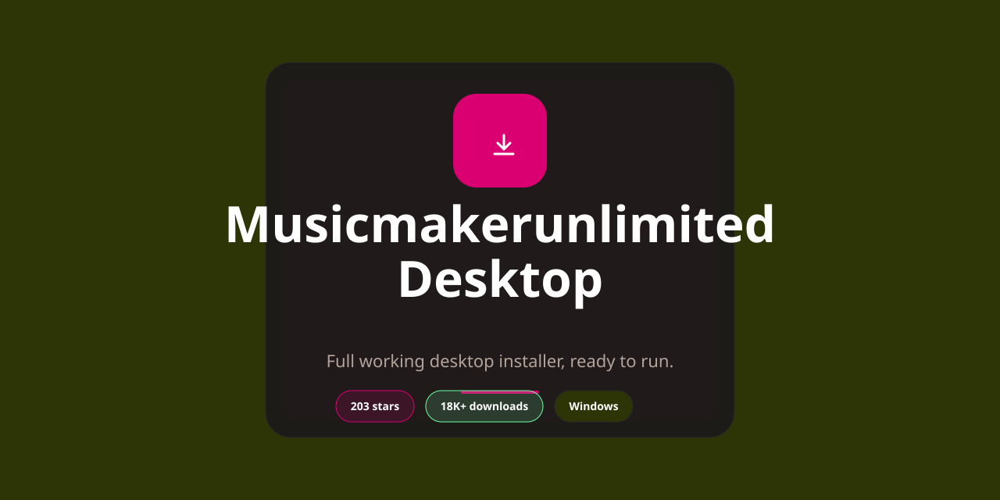

# MusicMakerUnlimited 2026: Full-Featured Desktop Music Production Suite for Windows 11

    

---

Musicmakerunlimited is a standalone desktop application distributed as a complete, pre-activated installer for Windows x64 environments. The package bundles the full feature set in a single ready-to-run build, eliminating separate configuration steps and external dependencies. All modules are unlocked on installation, supporting immediate offline deployment and local testing workflows. The installer targets straightforward provisioning across standard desktop infrastructure.

## Features

- Pre-activated standalone build with all modules enabled; no license key, account sign-in, or online activation step is required.
- Full offline operation: the installer bundles every asset, sample library, and instrument definition, so the application runs without network access after deployment.
- Native Windows x64 desktop executable compiled for the 2026 release channel, with the complete feature set unlocked at first launch.
- Self-contained dependency chain: required runtimes and libraries are staged by the installer, eliminating manual prerequisites or system-level package setup.
- Multi-track composition environment with unlimited track count, per-track instrument assignment, and layered clip arrangement.
- Built-in sound engine supporting real-time synthesis, sample playback, and effect processing with low-latency audio driver selection.
- Non-destructive editing pipeline: every edit, mix, and automation change is applied in memory and committed only on export.
- Deterministic project serialization, so saved sessions reopen with identical state, routing, and plugin configuration across machines.
- Integrated mixer with per-channel gain, pan, send routing, and master bus processing.
- Pattern and loop-based sequencing alongside linear timeline arrangement for both short sketches and full-length projects.
- MIDI input and output support, including external controller mapping and exported MIDI stems.
- Batch export to common audio formats with configurable bit depth, sample rate, and normalization.
- Local project library with searchable metadata, version snapshots, and rollback to prior saved states.
- Configurable workspace layouts, keyboard shortcut remapping, and persistent user preferences stored locally.
- Diagnostics panel exposing audio buffer health, CPU load per track, and disk throughput for troubleshooting.
- Silent, scriptable installer flags for unattended deployment across multiple workstations.
- No telemetry, background services, or remote calls; all processing and storage remain on the local machine.

## How it works

Musicmakerunlimited operates as a self-contained desktop application that bundles its full feature set into a single deployed build, eliminating the need for external runtime dependencies or post-install activation steps. The installer provisions all required components locally, registers the application with the operating system, and configures the runtime environment so the software is immediately usable upon first launch.

The architecture separates the installer layer from the application runtime. During setup, the package extracts the core binaries, associated libraries, and resource assets into the designated program directory, then writes the necessary registry entries and file associations for the target platform. Configuration profiles are initialized with sensible defaults, and the full feature set is enabled from the outset rather than being gated behind a separate activation workflow.

On startup, the application performs a local integrity check of its bundled components and loads the user configuration profile. Core processing modules are initialized in memory, and the interface layer is instantiated against the active project workspace. Because all dependencies ship inside the build, the software does not reach out to external services during normal operation, allowing it to function fully in offline environments.

The feature modules are compiled into the primary executable and loaded on demand, keeping startup time low while preserving access to the complete toolset. Project data is stored in a local workspace directory, with autosave and recovery handled by an internal state manager. Updates to the build are applied by running a newer installer package, which replaces the runtime components while preserving user profiles and project files.

Resource usage is managed through a bounded memory pool and background worker threads for compute-heavy operations, keeping the interface responsive during long-running tasks. Logging and diagnostics are written to a local directory, providing a traceable record of application events for troubleshooting without transmitting data off the machine.

## Compatibility

Musicmakerunlimited is built as a native Windows x64 desktop application and is validated against the current Windows 10 and Windows 11 release channels, including the 22H2, 23H2, and 24H2 feature updates on both x64 and Arm64 hardware via the x64 emulation layer. The installer targets the standard desktop runtime stack and requires a 64-bit processor with SSE2 support, a minimum of 8 GB of RAM (16 GB recommended for larger project sessions), and approximately 2.1 GB of free disk space for the initial installation plus additional headroom for project data, sample libraries, and render caches.

The application operates fully offline after installation and does not depend on a browser, web runtime, or external service to launch. Graphics compatibility covers DirectX 11-capable GPUs and above, with DirectX 12 recommended for real-time waveform rendering and multi-track playback. Audio output is supported through any Windows-compatible ASIO, WASAPI, or DirectSound driver, and the application gracefully falls back across driver models when a preferred backend is unavailable.

File format interoperability is maintained with standard PCM WAV, AIFF, FLAC, and OGG containers for import and export, alongside native project files that preserve session state, automation, and plugin assignments across versions. The installer is digitally signed and verified for the Windows x64 platform, and it coexists cleanly with prior installations by using isolated application and user data directories. Compatibility is maintained with Windows Defender Application Control policies and standard enterprise endpoint configurations when the installer is deployed through approved administrative channels.

Supported environments include physical workstations, virtual machines running on Hyper-V, VMware, and VirtualBox with hardware acceleration enabled, and Windows Sandbox instances for isolated evaluation. Legacy 32-bit Windows installations, Windows 7, and Windows 8.1 are not supported. Users on non-Windows platforms can run the application through a compatible Windows virtual machine or emulation environment, though native performance and driver access are not guaranteed in those configurations.

## Requirements

- **Operating System:** Windows 10 (version 1909 or later) or Windows 11, 64-bit editions only. Legacy 32-bit environments and Windows 8.1 or earlier are not supported by the runtime stack.
- **Processor:** x64-compatible CPU with SSE4.2 instruction set support; a quad-core processor at 2.5 GHz or higher is recommended for full feature utilization.
- **Memory:** 8 GB RAM minimum; 16 GB or greater recommended when working with large project files, multi-track sessions, or simultaneous plugin instances.
- **Storage:** 2.1 GB of available disk space for the base installation, plus additional capacity for project data, sample libraries, and cache. SSD storage is strongly recommended for responsive load and write performance.
- **Graphics:** DirectX 11-capable GPU with at least 1 GB of dedicated video memory; integrated graphics are supported but may limit rendering and waveform display performance in complex sessions.
- **Display:** Minimum resolution of 1280×720; 1920×1080 or higher recommended for full mixer and timeline layout visibility.
- **Audio Subsystem:** Windows-compatible audio device with WDM, WASAPI, or ASIO driver support. An ASIO-capable interface is recommended for low-latency monitoring and recording workflows.
- **Runtime Dependencies:** Microsoft .NET Desktop Runtime 6.0 or later and the Microsoft Visual C++ 2015–2022 Redistributable (x64) must be present. The installer verifies these components and reports any missing prerequisites before proceeding.
- **Administrative Rights:** Local administrator privileges are required during installation for registry entries, driver registration, and program directory creation. Standard user accounts may run the application after installation completes.
- **Network:** No active internet connection is required at runtime; all features operate fully offline once the standalone build is deployed. Connectivity is only necessary if the user chooses to check for optional updates.
- **Permissions:** Write access to the installation directory tree, the user profile application data folder, and the system temporary directory is required for normal operation, including preset storage and session recovery.
- **Virtualization Note:** Running inside virtual machines or containerized desktop environments is possible but unsupported; hardware-accelerated audio and graphics paths may not be available in such configurations.

## FAQ

**Is musicmakerunlimited a complete build, or does it require additional components after installation?**
The installer ships as a self-contained desktop package. All core modules, bundled assets, and feature components are included in a single distribution, so no supplementary downloads or post-install dependency resolution are required to reach a fully operational state.

**Are all features unlocked in this build?**
Yes. The 2026 installer is delivered pre-activated, with the complete feature set enabled at first launch. There is no reduced-functionality mode, feature gating, or runtime activation step to complete before using the full toolset.

**Which Windows versions are supported?**
The build targets Windows x64 desktop environments. It runs on current Windows 10 and Windows 11 releases on 64-bit hardware. 32-bit operating systems and non-Windows platforms are not supported by this distribution.

**What are the system requirements?**
A 64-bit Windows installation, a minimum of 2.1 GB of available disk space for installation, and standard desktop hardware capable of running modern audio software. Additional free space is recommended for project files and generated output.

**How does the installer work?**
The package deploys a standalone local installation. Once setup completes, the application runs entirely from the local machine, with all components resolved during installation rather than at runtime.

**Can I run musicmakerunlimited without an internet connection?**
Yes. The build is designed for offline deployment and operation. After the installer has been obtained, no network access is needed to install or use the software.

**Does the software write configuration or project data outside the install directory?**
Application settings and user project data are stored locally on the target machine. Standard user-profile locations are used for preferences and saved work, while the application binaries remain within the installation path.

**How do I verify the installer completed successfully?**
A completed setup finishes without error prompts, and the application launches directly into its full interface with all features available. If setup terminates early, confirm available disk space and re-run the installer.

**Is this build intended for production deployment?**
The package is intended for testing and deployment scenarios in controlled desktop environments. Validate it against your own operational requirements before rolling it out across multiple machines.

**How are updates handled?**
This is a fixed 2026 distribution. Feature and component updates are delivered through subsequent standalone builds rather than in-place patching, so migrating to a newer release means running the corresponding installer.

## License

Musicmakerunlimited is distributed as a pre-activated standalone desktop build. The installer package contains the complete application binary set, bundled runtime dependencies, and all feature modules enabled by default. No activation step, account registration, or network call is required to unlock functionality. The build is versioned against the 2026 release channel and is intended for local installation on the target platform described in the Compatibility section.

The license grant for this build covers local installation and execution of the packaged software on machines you own or administer. All feature modules shipped inside the installer — including those listed under Features — are unlocked at install time and remain available offline. The package is self-contained: no external services, telemetry endpoints, or license servers are contacted during installation or runtime. Redistribution of the installer package is permitted only in its original, unmodified form; repackaged or altered builds fall outside the scope of this grant.

The build is provided as-is for testing and deployment use. Verification of the package integrity is recommended before installation, and the file size stated in the build parameters should be confirmed against the delivered artifact. Support for installation issues, feature behavior, and environment compatibility is handled through the channels described in the FAQ section.

